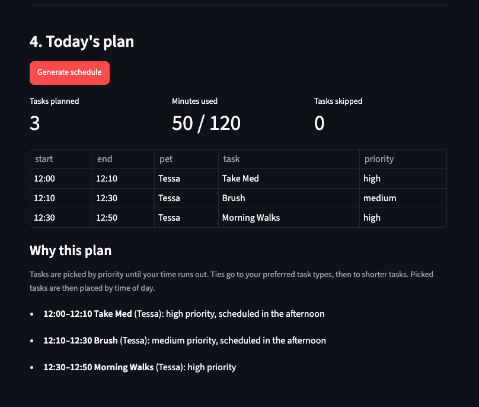
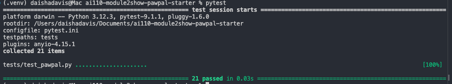

# PawPal+ (Module 2 Project)

You are building **PawPal+**, a Streamlit app that helps a pet owner plan care tasks for their pet.

## Scenario

A busy pet owner needs help staying consistent with pet care. They want an assistant that can:

- Track pet care tasks (walks, feeding, meds, enrichment, grooming, etc.)
- Consider constraints (time available, priority, owner preferences)
- Produce a daily plan and explain why it chose that plan

Your job is to design the system first (UML), then implement the logic in Python, then connect it to the Streamlit UI.

## What you will build

Your final app should:

- Let a user enter basic owner + pet info
- Let a user add/edit tasks (duration + priority at minimum)
- Generate a daily schedule/plan based on constraints and priorities
- Display the plan clearly (and ideally explain the reasoning)
- Include tests for the most important scheduling behaviors

## Getting started

### Setup

```bash
python -m venv .venv
source .venv/bin/activate  # Windows: .venv\Scripts\activate
pip install -r requirements.txt
```

### Suggested workflow

1. Read the scenario carefully and identify requirements and edge cases.
2. Draft a UML diagram (classes, attributes, methods, relationships).
3. Convert UML into Python class stubs (no logic yet).
4. Implement scheduling logic in small increments.
5. Add tests to verify key behaviors.
6. Connect your logic to the Streamlit UI in `app.py`.
7. Refine UML so it matches what you actually built.

## 🖥️ Sample Output

A generated plan for one pet, Tessa, with 120 minutes available:



```
Tasks planned: 3    Minutes used: 50 / 120    Tasks skipped: 0

12:00–12:10  Take Med       (Tessa)  high priority, scheduled in the afternoon
12:10–12:30  Brush          (Tessa)  medium priority, scheduled in the afternoon
12:30–12:50  Morning Walks  (Tessa)  high priority
```

## 🧪 Testing PawPal+

```bash
# Run the full test suite:
pytest

# Run with coverage:
pytest --cov
```

Sample test output:



```
platform darwin -- Python 3.12.3, pytest-9.1.1, pluggy-1.6.0
configfile: pytest.ini
testpaths: tests
collected 21 items

tests/test_pawpal.py .....................                    [100%]

============================== 21 passed in 0.03s ==============================
```

## 📐 Smarter Scheduling

`Scheduler.generate_plan()` builds the day in two passes: first it **chooses** which tasks fit, then it **places** the chosen tasks on the clock.

| Feature | Method(s) | Notes |
|---------|-----------|-------|
| Task sorting | `Scheduler._sort_tasks()`, `Task.priority_score()` | Sorts by priority (high → low). Ties go to task types listed in `Owner.preferences`, then to shorter tasks so more tasks fit. |
| Filtering | `Scheduler.generate_plan()`, `Scheduler._fits_in_time()`, `DailyPlan.skip()` | Completed tasks are left out. Tasks are added in sorted order while they fit in `Owner.available_minutes`. A task that doesn't fit is skipped with a reason (e.g. "needs 90 min but only 30 min left"), and smaller tasks after it can still be added. |
| Time-of-day placement | `Scheduler.generate_plan()` | Chosen tasks are ordered morning → afternoon → evening → any time, starting at `Owner.day_start`. Afternoon tasks start no earlier than 12:00 and evening tasks no earlier than 17:00. |
| Conflict handling | `Scheduler.generate_plan()` | Tasks are placed back to back on a single clock, so two scheduled tasks never overlap, even across different pets. |
| Explaining the plan | `Scheduler._reason()`, `DailyPlan.explain()`, `DailyPlan.to_table()` | Each scheduled task gives the reason it was picked (priority, owner preference, time of day). Each skipped task gives the reason it was left out. |
| Recurring tasks | Not implemented | Tasks are planned for one day at a time. Marking a task done (`Task.mark_complete()`) removes it from that day's plan. |

## 📸 Demo Walkthrough

Describe your app in numbered steps so a reader can follow along without watching a video:

1. **Launch the app.** Run `streamlit run app.py` and open the local URL that Streamlit prints. The page has four numbered sections: Owner, Pets, Tasks, and Today's plan.
2. **Enter owner info.** In **1. Owner**, type your name, set the **minutes available today** (for example, 120), choose when your **day starts**, and optionally pick **preferred task types** (such as `walk`). The scheduler uses preferences to break ties between tasks with the same priority.
3. **Add a pet.** In **2. Pets**, enter the pet's name, species, age, and optional notes, then click **Add pet**. The pet appears in a list below the form with a **Remove** button. Empty or duplicate pet names are rejected.
4. **Add care tasks.** In **3. Tasks**, pick the pet, then enter a task title, duration in minutes, priority (low / medium / high), type, and preferred time of day (any / morning / afternoon / evening). Click **Add task**. The pet's tasks are shown in a table below the form.
5. **Edit a task (optional).** Open **Edit a task**, choose a task, change any field, and click **Save changes**. From the same panel you can **Mark done** (done tasks are left out of the plan) or **Delete task**.
6. **Generate the plan.** In **4. Today's plan**, click **Generate schedule**. The app shows how many tasks were planned, minutes used compared with minutes available, and how many tasks were skipped. Below that is a table of start and end times, pet, task, and priority.
7. **Read the reasoning.** Under **Why this plan**, each scheduled task gives the reason it was picked (its priority, an owner preference, or its time of day). Tasks that didn't fit in the available time appear under **Skipped**, each with a reason such as "needs 90 min but only 30 min left".
8. **Adjust and regenerate.** Change the available minutes, priorities, or times of day, then click **Generate schedule** again to see how the plan changes.

**Screenshot or video** *(optional)*: <!-- Insert a screenshot or link to a demo video here -->
